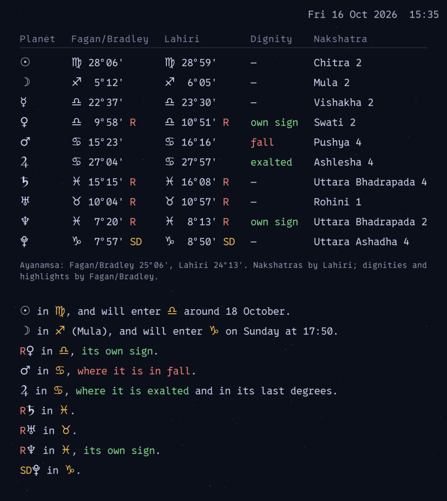

# Noctalia 5 widgets

Astronomy and astrology desktop widgets for [Noctalia](https://github.com/noctalia-dev) v5.
Both compute everything locally with the Swiss Ephemeris (no internet needed)
and redraw themselves every minute.

<p>
  
  
</p>

## The widgets

### [Orrery](orrery/)

The solar system right now, seen obliquely from the north, with a table of
positions.

- The Sun, Mercury to Pluto, the Moon and Chiron on their true orbits, at
  their true inclination, with height markers above and below the ecliptic
- A zodiac ring, **tropical** or **sidereal (Fagan/Bradley)**, with the Sun's
  sign highlighted and a sight line from Earth
- The Moon's **north and south nodes**, the **galactic center** and the
  **Great Attractor** on the ring, each one can be switched off
- A table with longitude, latitude, sign, distance from the Sun and from
  Earth, and light travel time, in heliocentric or geocentric order

[Full description and settings →](orrery/README.md)

### [Ephemeris](ephemeris/)

Today's sidereal positions for astrologers.

- Sun, Moon, Earth and the planets in both the **Fagan/Bradley** and the
  **Lahiri** zodiac
- **Retrograde** and **stationary** markers (R, SR, SD) and **dignities**
  (own sign, exalted, detriment, fall)
- **Nakshatra** and **pada** of every body, optionally in **Sanskrit**
  (Devanagari)
- A short **summary** of the highlights: dignities, stations, last or first
  degrees and coming sign changes (the Moon's with the time)
- Heliocentric or geocentric (Ptolemaic) planet order

[Full description and settings →](ephemeris/README.md)

## Requirements

- Noctalia v5 (plugin API 24)
- `python3` with **pycairo** and **pyswisseph**
- Fonts: DejaVu Sans and Noto Sans Symbols
- For Ephemeris's Sanskrit names only: **PyGObject** and Noto Sans Devanagari

Arch / CachyOS:

```sh
sudo pacman -S python-cairo python-gobject ttf-dejavu noto-fonts
paru -S pyswisseph               # AUR (or yay)
```

Without the AUR, each widget can use a private Python environment instead;
see the widget READMEs.

## Install

Add this repository as a plugin source, then enable the widgets you want:

```sh
noctalia msg plugins source add aha917 git https://github.com/aha917/noctalia5-widgets
noctalia msg plugins enable traditions/orrery
noctalia msg plugins enable traditions/ephemeris
```

Or from a local copy:

```sh
git clone https://github.com/aha917/noctalia5-widgets ~/noctalia5-widgets
noctalia msg plugins source add aha917 path ~/noctalia5-widgets
noctalia msg plugins enable traditions/orrery
noctalia msg plugins enable traditions/ephemeris
```

## Usage

1. Open the desktop widget editor: **Settings → Desktop → Widgets → Toggle
   Editor**, or run `noctalia msg desktop-widgets-edit`.
2. Choose **Orrery** or **Ephemeris** in the drop-down of the editor toolbar
   and press **+** to place it. Drag it into position.
3. To change its settings, **click the widget first**, then press the
   **gear** button in the toolbar. The toolbar buttons are greyed out until a
   widget is selected.
4. Press **Done** to leave the editor.

Every placed widget has its own settings, so you can, for example, show a
tropical Orrery on one monitor and a sidereal one on another.

## Update

Plugins from a git source are updated with
`noctalia msg plugins update traditions/orrery` (and `traditions/ephemeris`). If a new
setting does not show up afterwards, disable and enable the plugin once.

## License

Both widgets are AGPL-3.0-or-later, because they use the Swiss Ephemeris
(Astrodienst AG) under the AGPL. See the `LICENSE` file in each folder.
