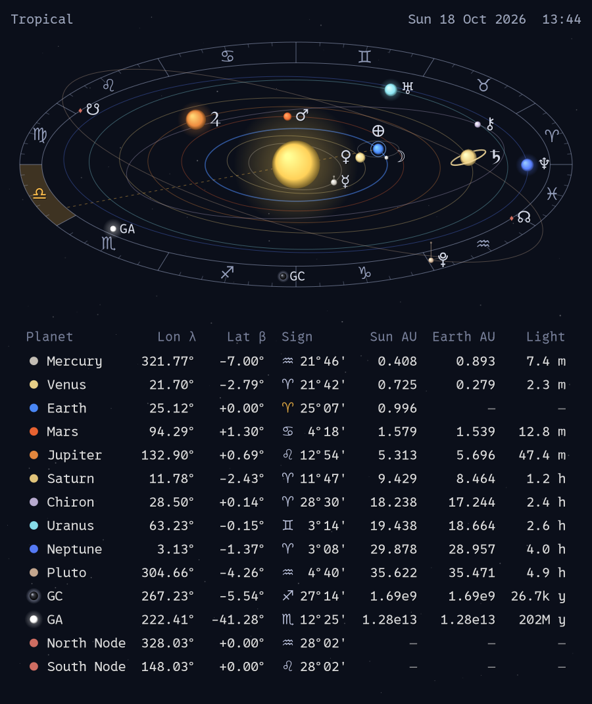

# Orrery



A Noctalia desktop widget showing the solar system as it is right now:
the Sun, Mercury to Pluto, the Moon, Chiron, the Moon's nodes (☊ ☋), the
galactic center (GC) and the Great Attractor (GA),
seen obliquely from the north, with the zodiac on the outer ring. The sign the
Sun is in, as seen from Earth, is highlighted, with a dashed sight line from
Earth through the Sun. The planets are labelled with their astrological
symbols. Below the picture is a table of positions:

| Column   | Meaning                                              |
|----------|------------------------------------------------------|
| Lon λ    | heliocentric ecliptic longitude (tropical, of date)  |
| Lat β    | heliocentric ecliptic latitude                       |
| Sign     | zodiac sign and degree (tropical or sidereal, see Zodiac setting) |
| Sun AU   | distance from the Sun                                |
| Earth AU | distance from Earth                                  |
| Light    | light travel time from the body to Earth             |

Distances in the picture are compressed so the inner planets stay visible.
Orbits and planets are drawn at their true inclination to the ecliptic; a thin
line with a dot marks how far a planet is above or below the ecliptic plane
(see the Lat β column). The Moon is shown on a small schematic circle around
Earth (it has no table row). The galactic center is drawn on the zodiac band
(it is far beyond any scale); its position is the J2000 value of Sgr A*
precessed to the date, at 8.18 kpc. The Great Attractor (GA, a white glowing ball) is drawn
the same way, at galactic l = 307°, b = +9° (Lynden-Bell et al. 1988), about
62 Mpc (200 million light years) away. The Moon's north and south nodes (true
node, geocentric) are small diamonds on the inner edge of the zodiac band at
their longitude, and have their own table rows.

Saturn, Jupiter and Pluto are drawn by the widget as vector outlines; the
other symbols come from fonts (DejaVu Sans, and Noto Sans Symbols for Earth
🜨). Each label sits in the nearest free spot around its planet.

## Requirements

- Noctalia v5 (plugin API 24)
- `python3` with **pycairo** and **pyswisseph** (Swiss Ephemeris)

Arch / CachyOS:

```sh
sudo pacman -S python-cairo ttf-dejavu noto-fonts
paru -S pyswisseph               # AUR (or yay)
```

Or, without the AUR, a private environment inside the plugin folder (the
widget uses `.venv/bin/python` when it exists):

```sh
cd ~/noctalia5-widgets/orrery   # or wherever the plugin folder is
python3 -m venv --system-site-packages .venv
.venv/bin/pip install pyswisseph
```

Test it: `python3 render.py /tmp/orrery.png` should write a PNG.

## Install

From this repository, as a plugin source:

```sh
noctalia msg plugins source add aha917 git https://github.com/aha917/noctalia5-widgets
noctalia msg plugins enable traditions/orrery
```

Or from a local copy:

```sh
git clone https://github.com/aha917/noctalia5-widgets ~/noctalia5-widgets
noctalia msg plugins source add aha917 path ~/noctalia5-widgets
noctalia msg plugins enable traditions/orrery
```

Then open the desktop widget editor and add **Orrery** to a monitor.

## Settings

| Setting    | Default | Notes                                        |
|------------|---------|----------------------------------------------|
| Size       | 680     | widget width in px                           |
| Interval   | 60      | seconds between redraws                      |
| Font       | 0xProto | labels and date; any installed font family   |
| Table font | 0xProto | the table (a monospaced font looks best)     |
| Font size  | 20      | 8–26; the widget grows taller with it        |
| Zodiac     | Tropical | or Sidereal (Fagan/Bradley): moves the signs on the ring and in the Sign column; Lon λ stays tropical |
| Show: galactic center | on | the GC on the band and in the table |
| Show: Great Attractor | on | the GA on the band and in the table |
| Show: Moon's nodes    | on | ☊ ☋ on the band and in the table |
| Show: zodiac label    | on | "Tropical" or "Sidereal: Fagan/Bradley" in the top left corner |
| Zodiac label size     | 20 | only shown while the label is on; equal to Font size it matches the date |
| Table order       | Heliocentric | or Geocentric: Earth, then the Moon's nodes, then Mercury, Venus, Mars… |

If the font is not installed, cairo falls back to a default font.

## Credits and license

Positions are computed with the Swiss Ephemeris by Astrodienst AG
(pyswisseph by Stanislas Marquis). Chiron comes from `ephe/seas_18.se1`, a
Swiss Ephemeris data file. The Swiss Ephemeris is dual-licensed under the
AGPL and the Swiss Ephemeris Professional License; this plugin uses it under
the AGPL and is therefore licensed under the GNU Affero General Public
License v3.0 or later (see `LICENSE`).
